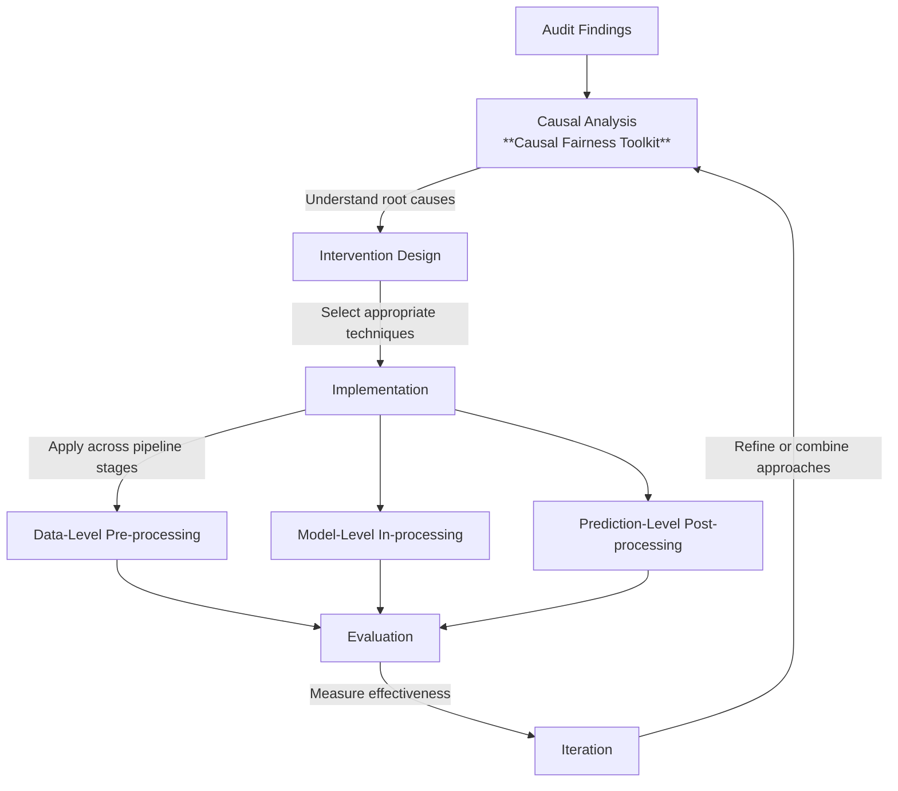

## Executive Summary

**Target audience:** ML engineers and data scientists implementing fairness improvements

**Purpose:** Practical guide for applying fairness interventions across the ML pipeline and
- **Analyze causal mechanisms of bias** by mapping relationships between protected attributes, features, and outcomes.
- **Design pre-processing interventions** by transforming, reweighting, and resampling your data.
- **Implement fairness-aware modeling** by incorporating constraints, adversarial techniques, and regularization.
- **Apply post-processing techniques** by optimizing thresholds and calibrating outputs.
- **Create integrated intervention strategies** by combining techniques across the ML pipeline.

**Prerequisites:** Completed fairness audit identifying specific issues to address

## Introduction
The Counterfactual Analysis Framework enables evaluation of whether an AI system exhibits causal discrimination by examining how predictions would change under counterfactual scenarios where protected attributes take different values.

### When to Use This Playbook

After completing a Fairness Audit Playbook, you'll have identified specific bias issues and unfair outcomes. This playbook guides you in selecting and implementing the right interventions.

### Intervention Philosophy

**Multi-stage approach:** Interventions can be applied at data, model, or prediction levels

**Causal thinking:** Understanding *why* bias exists helps choose effective interventions

**Trade-off awareness:** Every intervention involves accuracy, complexity, or interpretability trade-offs

**Iterative process:** Measure → Intervene → Re-measure → Refine

## Playbook Architecture

The integration of the four fairness toolkits—**Causal**, **Pre-Processing**, **In-Processing**, and **Post-Processing**—creates a cohesive, multi-stage methodology designed to transform conceptual fairness into operational reality. This workflow functions as a "fairness treatment plan," moving systematically from **diagnosis** (identifying root causes) to **targeted intervention** across the machine learning lifecycle.

### **Phase 1: The Diagnostic Foundation (Causal Fairness Toolkit)**
The workflow begins with the **Causal Fairness Toolkit**, which serves as the primary diagnostic engine for the entire pipeline. 

*   **Process:** Practitioners use domain knowledge and data analysis to build causal graphs that map the specific pathways—direct, indirect (mediator), or proxy—through which protected attributes influence outcomes.
*   **Outputs & Handoffs:** The toolkit identifies whether unfairness stems from **data representation**, **learning algorithms**, or **decision rules**. 
    *   **To Pre-Processing:** If the analysis identifies **proxy discrimination** (e.g., zip code acting as a proxy for race) or **representation gaps**, it directs the user to data-level fixes.
    *   **To In-Processing:** If it identifies **direct discrimination** or problematic **mediator pathways** that must be constrained during learning, it directs the user to model-level fixes.
    *   **To Post-Processing:** If it identifies disparities in the final **decision rules** or determines that retraining is impractical, it directs the user to output-level adjustments.

### **Phase 2: Data-Level Remediation (Pre-Processing Fairness Toolkit)**
The **Pre-Processing Toolkit** tackles bias at its source before any model training begins, using the specific causal mechanisms identified in Phase 1 to select the right tool.

*   **Inputs:** Biased training data and the causal diagnosis (e.g., identified proxy features or demographic imbalances).
*   **Process:** Techniques like **Disparate Impact Removal** are used to transform features and break identified proxy pathways, while **reweighting** or **synthetic data generation** are used to correct representation gaps.
*   **Outputs & Handoffs:** The result is a **"fairer" dataset** or representation. This refined data is then fed directly into the **In-Processing Toolkit** as the primary training input, ensuring the model starts from an equitable foundation.

### **Phase 3: Model-Level Remediation (In-Processing Fairness Toolkit)**
The **In-Processing Toolkit** embeds fairness directly into the model’s training process to address any bias that persists despite pre-processing fixes.

*   **Inputs:** The fairer dataset (from Phase 2), the chosen model architecture, and the causal requirements (e.g., specific pathways that must be blocked).
*   **Process:** The toolkit applies **adversarial debiasing** (to remove protected information from internal representations), **constrained optimization**, or **fairness regularization** to guide the model toward inherently fair decision boundaries.
*   **Outputs & Handoffs:** The output is a **fairness-aware model** that natively satisfies specified criteria. This model is then passed to the **Post-Processing Toolkit** for final validation and refinement.

### **Phase 4: Output-Level Remediation (Post-Processing Fairness Toolkit)**
The final stage, the **Post-Processing Toolkit**, adjusts model outputs to satisfy remaining fairness criteria without requiring a full retraining cycle.

*   **Inputs:** The model outputs (from Phase 3), the initial causal audit, and operational/regulatory constraints.
*   **Process:** The toolkit uses **threshold optimization** to equalize decision boundaries across groups and **probability calibration** to ensure scores have a consistent meaning regardless of demographics.
*   **Outputs:** The final product is a set of **fair decisions** or calibrated risk scores that are ready for production deployment.

### **Integrated Workflow Summary**
| Component           | Primary Function | Workflow Role                                                            |
| :------------------ | :--------------- | :----------------------------------------------------------------------- |
| **Causal Toolkit**  | **Diagnosis**    | Maps root causes to determine which later toolkit to prioritize.         |
| **Pre-Processing**  | **Data Fix**     | Transforms biased inputs into a fair foundation for the training loop.   |
| **In-Processing**   | **Model Fix**    | Embeds fairness into the model’s "heart" during training.                |
| **Post-Processing** | **Output Fix**   | Refines predictions at the interface to ensure equitable final outcomes. |

### Technical and Mathematical Sub-Components

To implement the toolkits above, the framework relies on several foundational modeling and inference components:

1. **Structural Causal Models (SCMs):** These provide the mathematical formalization of causal relationships, consisting of exogenous variables ($U$), endogenous variables ($V$), and structural equations ($F$).
2. **Counterfactual Generation Framework:** This involves a three-step process: **Abduction** (updating background variables based on evidence), **Action** (intervening on protected attributes), and **Prediction** (computing the alternative outcome).
3. **Observational Inference Methods:** When experimental data is missing, the framework employs techniques like **matching**, **instrumental variables (IV)**, and **regression discontinuity** to approximate counterfactual scenarios from historical data.
4. **Validation and Sensitivity Framework:** This component assesses model reliability through **sensitivity analysis** (calculating **E-values** to measure the impact of unmeasured confounders) and testing implied conditional independencies against observed data.

### Intersectional Considerations

A comprehensive framework explicitly addresses **intersectionality**, as discrimination often operates through unique pathways for individuals with overlapping marginalized identities. The playbook requires modeling **interaction terms** between attributes and using **intersectional causal graphs** to ensure that interventions do not leave compound discrimination mechanisms unaddressed.

### ****Evaluation and Trade-off Analysis****

Finally, the framework includes an **evaluation approach** that explicitly assesses **trade-offs** between fairness improvements and predictive performance. This ensures that practitioners can find an optimal balance between maintaining model utility and achieving ethical and legal fairness objectives.

### Domain-Specific Application & Validation
1. High-Stakes Case Study: Financial Lending
    A causal audit of a lending dataset reveals the following bias breakdown: 60% Proxy Discrimination (Zip Code), 25% Indirect Discrimination (Credit History), and 15% Selection Bias (Training Data).
    Technical Workflow:
    1. Causal Discovery: Map the "Redlining" path (Race→ZipCode→Outcome).
    2. Feature Repair: Apply Feldman’s transformation to Zip Code distributions with λ=0.8.
    3. In-Processing: Apply Lagrangian constraints for demographic parity with ϵ=0.05.
    4. Post-Processing: Use Reliability Diagrams to detect group-specific miscalibration, followed by Platt Scaling.
 2.  High-Stakes Case Study: Healthcare & Recidivism
    In recidivism risk assessment, the primary issue is interpretation inconsistency.
        • Intervention: We calculate the ECE for each racial group. If ECE is significantly higher for one group, we apply Isotonic Regression to the output scores. This ensures a "Medium Risk" score (e.g., 0.6) corresponds to the same empirical recidivism rate across all groups.
 3. Validation & Stress-Testing
    • Structural Validation: Test the causal model’s implied conditional independencies using d-separation tests. If the data violates these independencies, the graph is misspecified.
    • Sensitivity Analysis: Per Kilbertus et al. (2020), assess how unobserved confounders (U) impact counterfactual fairness. If a small correlation between U and A flips the fairness conclusion, the model is not robust.

## Implementation guidelines 
This implementation guide provides a structured methodology for applying the **Fairness Intervention Playbook** across the machine learning lifecycle. It moves from diagnosis (causal analysis) to treatment (data, model, and output-level interventions), ensuring that fairness is not an afterthought but a core optimization criterion.

---

### Phase 1: Diagnosis (Causal Fairness Toolkit)
The foundation of any intervention is understanding the **generative mechanisms** of bias. Without a causal model, interventions may target surface symptoms ("breaking the thermometer") rather than the underlying "fever".

*   **Key Decision Point: Identifying Discrimination Pathways**
    *   Practitioners must distinguish between **direct discrimination** (a path from protected attribute to outcome), **indirect discrimination** (paths through mediators), and **proxy discrimination** (associations through shared ancestors like zip codes).
*   **Supporting Evidence:** Pearl’s "ladder of causation" establishes that true fairness requires reasoning at the counterfactual level—imagining a world where an individual’s protected attribute was different while other factors remained constant.
*   **Identified Risks:** The primary risk is the presence of **unobserved confounders**—variables that affect both the protected attribute and the outcome but are not measured. This can lead to incorrect causal conclusions.
    *   *Mitigation:* Use **sensitivity analysis (E-values)** to quantify how strong an unmeasured factor would need to be to nullify your findings.

---

### Phase 2: Data-Level Remediation (Pre-Processing Toolkit)
Once a diagnosis is made, data-level interventions attempt to transform biased datasets into **fairer representations** before model training begins.

*   **Key Decision Point: Selecting the Transformation Type**
    *   **Reweighting:** Best for minor representation gaps when the model architecture supports instance weights.
    *   **Transformation (e.g., Disparate Impact Removal):** Essential when features act as proxies for protected attributes but contain legitimate predictive signals.
    *   **Synthetic Generation (e.g., GANs/VAEs):** Necessary when representation gaps are severe (e.g., <30 samples for an intersectional group).
*   **Supporting Evidence:** Research by Kamiran and Calders (2012) shows that reweighting can significantly reduce discrimination while maintaining predictive performance.
*   **Identified Risks: Information Loss vs. Fidelity.** Aggressive transformations may destroy legitimate predictive signals, while synthetic data may contain **artifacts** that lead to unrealistic feature combinations.

---

### Phase 3: Model-Level Remediation (In-Processing Toolkit)
In-processing embeds fairness directly into the model’s "heart" to address bias that persists despite pre-processing.

*   **Key Decision Point: Choosing the Algorithmic Approach**
    *   **Constraints:** Use when strict mathematical guarantees are required (e.g., demographic parity difference $\leq \epsilon$).
    *   **Adversarial Debiasing:** Ideal for complex neural networks handling unstructured data like text or images.
    *   **Regularization:** A flexible "middle ground" that guides the model toward fairness via soft penalties during training.
*   **Supporting Evidence:** Zhang et al. (2018) demonstrated that adversarial components can remove protected information from internal representations while maintaining model expressivity.
*   **Identified Risks: Training Instability.** Adversarial training often suffers from **mode collapse** or oscillating losses.
    *   *Mitigation:* Use **progressive training schedules** (gradually increasing the adversarial weight $\lambda$) and **learning rate asymmetry**.

---

### Phase 4: Prediction-Level Remediation (Post-Processing Toolkit)
Post-processing adjusts model outputs after training, providing immediate fixes for **deployed systems** where retraining is too costly or slow.

*   **Key Decision Point: Calibration vs. Error Parity**
    *   **Probability Calibration:** Prioritize when the **interpretation** of the risk score is paramount (e.g., medical diagnosis).
    *   **Threshold Optimization:** Prioritize when the system makes binary decisions and you must equalize error rates across groups.
*   **Supporting Evidence:** Pleiss et al. (2017) demonstrated that miscalibrated probabilities create uneven impact even if decision thresholds remain constant.
*   **Identified Risks: The "Impossibility Theorem."** It is mathematically impossible to simultaneously satisfy perfect calibration and equalized error rates if base rates differ between groups.

---

### Phase 5: Evaluation and Trade-off Management
The final step is navigating the **Pareto frontier**—the set of optimal solutions where no objective (accuracy) can be improved without degrading another (fairness).

*   **Key Decision Point: Preference Articulation**
    *   Stakeholders must decide on an **operating point** on the frontier. This involves a **value judgment** about the "price of fairness" (e.g., accepting a 2% drop in accuracy for a 70% reduction in disparity).
*   **Identified Risks: Fairness Gerrymandering.** Models may appear fair across broad demographics (e.g., race or gender separately) while exhibiting severe disparities at their **intersections** (e.g., Black women).
    *   *Mitigation:* Always calculate metrics for **intersectional subgroups** and explicitly include intersectional objectives in your multi-objective framework.

---

### **Summary Table: Implementation Risks and Mitigations**

| Phase | Primary Risk | Mitigation Strategy |
| :--- | :--- | :--- |
| **Causal Audit** | Unmeasured Confounders | Sensitivity Analysis (E-values) |
| **Pre-Processing** | Synthetic Data Artifacts | Expert Review & Statistical Distribution Tests |
| **In-Processing** | Optimization Instability | Progressive Weighting & GRL Implementation |
| **Post-Processing** | Calibration-Fairness Conflict | Explicit prioritization based on decision context |
| **Integrated Playbook** | Intersectional "Gerrymandering" | Stratified auditing & hierarchical regularization |

 Implementing the **Fairness Intervention Playbook** involves navigating distinct operational requirements across the machine learning lifecycle. The following summary outlines the practical organizational considerations for time, expertise, and integration.

### **1. Time Requirements and Speed of Deployment**
The time required for intervention varies significantly depending on the stage of the pipeline being addressed:
*   **Rapid Interventions (Post-Processing):** These are the most time-efficient. Techniques like threshold adjustment can be deployed in as little as **three days**, whereas model retraining often takes months due to development, validation, and regulatory review cycles.
*   **Development Overhead (In-Processing):** Embedding fairness directly into models increases computational and human time. **Constraint optimization** typically increases training time by **30–50%**.
*   **Foundational Efforts (Causal & Data Auditing):** Causal modeling is an **iterative process** that evolves as domain knowledge improves. Comprehensive data auditing is resource-intensive, particularly for high-dimensional datasets, but is a prerequisite for effective intervention.

### **2. Necessary Expertise**
A multidisciplinary team is required to ensure interventions are technically sound and ethically aligned:
*   **Domain Expertise:** Essential for constructing **causal graphs** and identifying which pathways represent legitimate predictive relationships versus discrimination.
*   **Technical ML & Deep Learning Proficiency:**
    *   **Adversarial methods** require specialized skills in managing training instability, mode collapse, and tuning complex hyperparameters.
    *   **Generative data augmentation** (e.g., GANs, VAEs) demands high-level deep learning expertise.
*   **Specialized Statistical Knowledge:** Implementing probability calibration and threshold optimization requires expertise in **ROC analysis** and statistical validation.
*   **Stakeholder Engagement:** Business leaders and compliance officers must be involved in **preference articulation**—the value-laden process of selecting an operating point on the **Pareto frontier** between accuracy and fairness.

### **3. Integration with Existing Development Processes**
Interventions are designed to slot into various stages of standard ML workflows:
*   **Data Pipeline Integration:** **Pre-processing** techniques (reweighting, resampling, and transformation) integrate directly into **ETL and data preparation** workflows.
*   **Training Loop Extensions:** **In-processing** interventions extend conventional training procedures by modifying loss functions or adding **gradient reversal layers**.
*   **Production & Black-Box Support:** **Post-processing** is highly compatible with existing production pipelines because it sits between the model output and the final decision interface. It is the only option for **black-box or legacy systems** where model internals cannot be accessed.
*   **Governance and Accountability:** All interventions must be integrated with **GRC (Governance, Risk, and Compliance)** frameworks. This includes maintaining **audit trails**, documenting selection rationales, and communicating trade-offs to stakeholders using visualizations like radar charts or Pareto plots.
