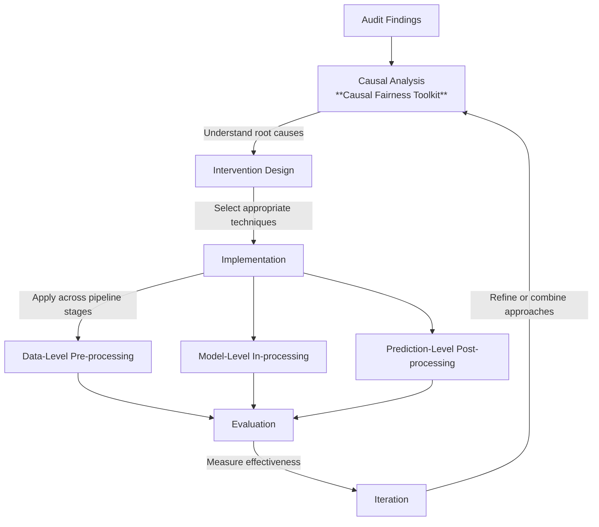

## Executive Summary

**Target audience:** ML engineers and data scientists implementing fairness improvements

**Purpose:** Practical guide for applying fairness interventions across the ML pipeline and
- **Analyze causal mechanisms of bias** by mapping relationships between protected attributes, features, and outcomes.
- **Design pre-processing interventions** by transforming, reweighting, and resampling your data.
- **Implement fairness-aware modeling** by incorporating constraints, adversarial techniques, and regularization.
- **Apply post-processing techniques** by optimizing thresholds and calibrating outputs.
- **Create integrated intervention strategies** by combining techniques across the ML pipeline.

**Prerequisites:** Completed fairness audit identifying specific issues to address

## Introduction
The Counterfactual Analysis Framework enables evaluation of whether an AI system exhibits causal discrimination by examining how predictions would change under counterfactual scenarios where protected attributes take different values.

### When to Use This Playbook

After completing a Fairness Audit Playbook, you'll have identified specific bias issues and unfair outcomes. This playbook guides you in selecting and implementing the right interventions.

### Intervention Philosophy

**Multi-stage approach:** Interventions can be applied at data, model, or prediction levels

**Causal thinking:** Understanding *why* bias exists helps choose effective interventions

**Trade-off awareness:** Every intervention involves accuracy, complexity, or interpretability trade-offs

**Iterative process:** Measure → Intervene → Re-measure → Refine

## Playbook Architecture

The playbook is built on a series of specialized toolkits that target different stages of the 
### The Intervention Pipeline
- **Causal Fairness Toolkit:** This foundational component identifies optimal intervention points by mapping the causal paths between protected attributes and outcomes. It enables practitioners to distinguish between **direct discrimination** (direct paths to outcome), **indirect discrimination** (paths through mediators), and **proxy discrimination** (relationships through shared ancestors).
- **Pre-Processing Fairness Toolkit:** This toolkit provides **data-level interventions** to address representation issues before model training begins. Key techniques include **reweighting** to adjust sample importance, **transforming features** to remove problematic correlations, and **resampling** or generative approaches to augment underrepresented groups.
- **In-Processing Fairness Toolkit:** These interventions integrate fairness **directly into the learning algorithm**. It utilizes **constraint optimization, adversarial debiasing, and regularization** to ensure the model architecture itself blocks unwanted causal pathways.
- **Post-Processing Fairness Toolkit:** Designed for situations where retraining is impractical or costly, this toolkit adjusts **model outputs** after training. It focuses on **threshold optimization, output calibration**, and **rejection learning** for uncertain predictions.
- **Pipeline Integration Strategy:** The final component synthesizes these toolkits into a **cohesive, multi-stage methodology**. This strategy coordinates interventions across the pipeline to ensure that data, model, and output adjustments work in harmony rather than creating redundant or conflicting constraints.

### Technical and Mathematical Sub-Components

To implement the toolkits above, the framework relies on several foundational modeling and inference components:

1. **Structural Causal Models (SCMs):** These provide the mathematical formalization of causal relationships, consisting of exogenous variables ($U$), endogenous variables ($V$), and structural equations ($F$).
2. **Counterfactual Generation Framework:** This involves a three-step process: **Abduction** (updating background variables based on evidence), **Action** (intervening on protected attributes), and **Prediction** (computing the alternative outcome).
3. **Observational Inference Methods:** When experimental data is missing, the framework employs techniques like **matching**, **instrumental variables (IV)**, and **regression discontinuity** to approximate counterfactual scenarios from historical data.
4. **Validation and Sensitivity Framework:** This component assesses model reliability through **sensitivity analysis** (calculating **E-values** to measure the impact of unmeasured confounders) and testing implied conditional independencies against observed data.

### Intersectional Considerations

A comprehensive framework explicitly addresses **intersectionality**, as discrimination often operates through unique pathways for individuals with overlapping marginalized identities. The playbook requires modeling **interaction terms** between attributes and using **intersectional causal graphs** to ensure that interventions do not leave compound discrimination mechanisms unaddressed.

### ****Evaluation and Trade-off Analysis****

Finally, the framework includes an **evaluation approach** that explicitly assesses **trade-offs** between fairness improvements and predictive performance. This ensures that practitioners can find an optimal balance between maintaining model utility and achieving ethical and legal fairness objectives.

### Domain-Specific Application & Validation
1. High-Stakes Case Study: Financial Lending
    A causal audit of a lending dataset reveals the following bias breakdown: 60% Proxy Discrimination (Zip Code), 25% Indirect Discrimination (Credit History), and 15% Selection Bias (Training Data).
    Technical Workflow:
    1. Causal Discovery: Map the "Redlining" path (Race→ZipCode→Outcome).
    2. Feature Repair: Apply Feldman’s transformation to Zip Code distributions with λ=0.8.
    3. In-Processing: Apply Lagrangian constraints for demographic parity with ϵ=0.05.
    4. Post-Processing: Use Reliability Diagrams to detect group-specific miscalibration, followed by Platt Scaling.
 2.  High-Stakes Case Study: Healthcare & Recidivism
    In recidivism risk assessment, the primary issue is interpretation inconsistency.
        • Intervention: We calculate the ECE for each racial group. If ECE is significantly higher for one group, we apply Isotonic Regression to the output scores. This ensures a "Medium Risk" score (e.g., 0.6) corresponds to the same empirical recidivism rate across all groups.
 3. Validation & Stress-Testing
    • Structural Validation: Test the causal model’s implied conditional independencies using d-separation tests. If the data violates these independencies, the graph is misspecified.
    • Sensitivity Analysis: Per Kilbertus et al. (2020), assess how unobserved confounders (U) impact counterfactual fairness. If a small correlation between U and A flips the fairness conclusion, the model is not robust.

### Implementation guidelines
 [addressing practical organizational considerations like 
 time requirements, 
 necessary expertise, 
 and integration with existing development processes.]
 
[2 Monitoring & Model Cards
• Weight Drift: Continuous monitoring must detect if the importance weights calculated during pre-processing have drifted due to changes in the deployment population.
• Deployment Audits: Maintain Model Cards documenting the causal assumptions (DAGs), the specific fairness definitions enforced (Counterfactual vs Statistical), and the ECE metrics across demographic intersections.]