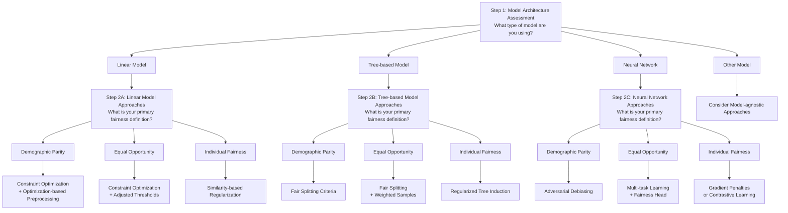

# In-Processing Fairness Toolkit

### **Purpose & Scope**

*   **Problem:** Traditional machine learning workflows often treat fairness as an afterthought, relying on data pre-processing that may leave residual biases or post-hoc corrections that fail to address how a model constructs its decision boundaries. Even when pre-processing is applied, significant gaps in fairness—such as disparities in loan approval rates for similarly qualified applicants—can persist.

*   **Primary Function:** The **In-Processing Fairness Toolkit** provides a structured methodology to **embed fairness directly into the model training process**. It moves beyond modifying inputs to reshaping the "heart" of the model, enabling algorithms to natively satisfy fairness definitions while simultaneously optimizing for predictive performance.
*   **Outputs:**
    *   A **Model Architecture Analysis Template** for identifying compatibility between specific model types (linear, tree-based, neural networks) and fairness techniques.
    *   A **Technique Selection Decision Tree** that guides users from abstract fairness goals to concrete in-processing methods like **adversarial debiasing**, **constrained optimization**, or **fairness regularization**.
    *   An **Implementation Pattern Catalog** featuring reusable code templates for incorporating fairness into training loops.
    *   An **Integration Verification Framework** for rigorously validating improvements against baselines and testing robustness across data subsets.
*   **Scope / Limits:** The toolkit focuses on **model-level interventions** during the learning phase. While powerful, these techniques are often more computationally resource-intensive, introduce greater training complexity, and require navigating fundamental **theoretical trade-offs** between accuracy and equity.

### **Primary Stakeholders**

*   **Data Science and Engineering Teams:** Responsible for analyzing model architectures, implementing mathematical constraints into training loops, and managing the unique optimization dynamics of adversarial or multi-objective frameworks.
*   **Risk Management Teams:** Focused on ensuring the model maintains high predictive accuracy and assessing the "price of fairness" in terms of portfolio performance or default risk.
*   **Compliance and GRC Officers:** Stakeholders who define the regulatory and non-discrimination standards the system must meet and who use the toolkit’s verification frameworks to document adherence to legal requirements.
*   **Business Leaders and Executives:** Decision-makers who must balance profitability and business goals with ethical considerations, often selecting the final "operating point" on a **Pareto frontier**.
*   **End-Users/Applicants:** The individuals (e.g., borrowers or job candidates) seeking equitable access and fair evaluation from the automated system.

### **Integration Points in the GRC Lifecycle**

*   **Risk Assessment & Identification:** The toolkit integrates early by providing a **Model Architecture Analysis Template** to identify where current models may be incompatible with fairness goals or where "fairness gerrymandering" might occur. It allows teams to explicitly model the **inherent tensions** between performance metrics and societal values.
*   **Policy Translation:** It serves as a bridge between abstract legal/ethical policies and technical implementation by **translating fairness definitions** (like demographic parity or equalized odds) into precise mathematical constraints and optimization objectives.
*   **Mitigation & Controls:** During the development phase, the toolkit acts as a control mechanism by **embedding fairness as a core optimization criterion**. Techniques like **adversarial unlearning** actively filter out protected attribute information from model representations, providing "representational protection" by design.
*   **Monitoring & Validation:** The **Integration Verification Framework** provides a standardized protocol for baseline establishment and robustness testing. Methods like **protected attribute leakage testing** and **Pareto optimality verification** ensure that fairness controls are functioning as intended before deployment.
*   **Governance & Accountability:** The toolkit facilitates **preference articulation**, a structured process where stakeholders iteratively refine and document the rationales behind specific trade-off decisions. This creates a transparent and defensible audit trail of why a particular balance between accuracy and equity was chosen.

## Model Architecture Analysis Template
This template analyzes model compatibility with fairness techniques:

Model Type Classification:

### Model Architecture Assessment
1. Model family:
   - [ ] Linear models (logistic regression, linear SVM)
   - [ ] Tree-based models (decision trees, random forests, gradient boosting)
   - [ ] Neural networks (feedforward, convolutional, recurrent)
   - [ ] Other (specify: ____________)

2. Model characteristics:
   - [ ] Training approach (batch, online, etc.)
   - [ ] Loss function
   - [ ] Regularization methods currently used
   - [ ] Hyperparameter tuning approach

3. Technical constraints:
   - Available computational resources
   - Maximum acceptable training time increase
   - Explainability requirements
   - Deployment environment limitations

### Compatibility Matrix:

| Fairness Technique      | Linear Models | Tree-based Models | Neural Networks |
| ----------------------- | ------------- | ----------------- | --------------- |
| Constraint Optimization | High          | Low               | Medium          |
| Adversarial Debiasing   | Low           | Low               | High            |
| Fairness Regularization | High          | Medium            | High            |
| Fair Representations    | High          | Low               | Medium          |
| Specialized Algorithms  | Medium        | High              | Low             |
	
### Implementation Considerations by Model Family:

#### Linear Models
- **Primary Techniques:** Constraint Optimization and Fairness Regularization.
- **Modification Approach:** Integrate fairness constraints (e.g., demographic parity) directly into the objective function using Lagrangian multipliers.
- **Performance Impact:** Works most reliably with convex loss functions.
- **Explainability:** High; fairness interventions generally preserve the interpretability of feature coefficients.
- **Limitations:** Hard equality constraints may prove infeasible if underlying data disparities are severe; inequality constraints with tolerance (ϵ) are often required.

#### Tree-based Models
- **Primary Techniques:** Specialized Algorithms and Fairness Regularization.
- **Modification Approach:** Implement fair splitting criteria by modifying impurity metrics (e.g., Gini/Entropy) to penalize divisions that increase demographic disparity.
- **Performance Impact:** Minimal accuracy reduction if weighted samples or false-negative penalties are used during tree induction.
- **Explainability:** High; remains compliant with regulatory requirements for transparent decision rationales.
- **Limitations:** Generally incompatible with adversarial debiasing as they are not natively differentiable.

#### Neural Networks (Deep Learning)
- **Primary Techniques:** Adversarial Debiasing and Fair Representations.
- **Modification Approach:** Employ a minimax game where a predictor maximizes accuracy while an adversary attempts to infer protected attributes from internal representations or outputs.
- **Performance Impact:** High expressivity allows for smoother trade-offs, but implementations are prone to training instability and require specialized optimization like gradient reversal layers.
- **Explainability:** Low; internal "censored representations" are often latent and difficult to interpret.
- **Unique Advantage:** Particularly effective for complex inputs (text, images) where bias is encoded in non-linear, subtle patterns.

### Decision Criteria for Selection
- Select **Adversarial Debiasing** if: You are using differentiable architectures (**neural networks**), handling complex data, and need to protect internal representations rather than just final outputs.
- Select **Constraint Optimization** if: You require **mathematical guarantees about fairness** properties and are using **simpler, convex models**.
- Select **Fairness Regularization** if: You need a flexible middle ground that offers stable optimization and can be easily integrated into existing loss functions across diverse architectures.
- Select **Specialized Algorithms** if: You are constrained by explainability requirements and are utilizing tree-based structures like Gradient Boosting.

## 2 Technique Selection Decision Tree

This decision tree guides users to appropriate techniques:

## 3 Implementation Pattern Catalog
This catalog provides implementation patterns:

### Pattern 1: Constraint Optimization for Linear Models
This pattern uses Lagrangian methods to transform hard fairness constraints into manageable penalties within the objective function. It is most effective for linear models with convex loss functions

**Approach:** Add fairness constraints (e.g., demographic parity) to the standard loss function using Lagrange multipliers (λ).

**Components:**
- Modified objective function with fairness constraints
- Relaxation parameters for constraint satisfaction
- Learning rate adjustments for constrained optimization

**Parameters:**
- Constraint weight (controls fairness-performance trade-off)
- Slack variable bounds (if applicable)
- Convergence criteria adjustments

**Implementation Considerations:**
- May require specialized solvers
- Often increases training time by 30-50%
- Works best with convex loss functions

### Pattern 2: Adversarial Debiasing for Neural Networks
This pattern employs a minimax game where a "predictor" network aims for accuracy while an "adversary" network tries to infer protected attributes from internal representations or outputs.

**Approach:** 
Implement a Gradient Reversal Layer (GRL) between the predictor and adversary to allow the predictor to minimize primary loss while maximizing the adversary's loss

**Components:**
- Main model architecture (predictor)
- Adversary network architecture
- Gradient reversal layer
- Combined loss function

**Parameters:**
- Adversary weight (controls fairness-performance trade-off)
- Adversary architecture complexity
- Gradient scaling factor
- Implementation Considerations:
- Requires careful balancing of main and adversary training
- Training instability can occur with improper hyperparameters
- Works best with larger datasets

### Pattern 3: Fairness Regularization (Tree-based/General Models)
Regularization guides models toward fairness by penalizing discriminatory behavior during training without enforcing rigid boundaries.

**Logic:** For tree-based models, modify the split-finding criterion to penalize divisions that increase demographic disparity.
**Advantage:** Offers a smoother optimization landscape and more stable training than adversarial methods.

### Pattern 4: Multi-Objective Scalarization (Navigating Trade-offs)
This pattern explicitly models the Pareto frontier, allowing stakeholders to select the optimal balance between performance and equity.

**Logic:** Combine multiple objectives into a single value using weighted sums.
**Outcome:** Provides visibility into the "price of fairness" (performance reduction per unit of fairness improvement).

### Pattern 5: Intersectional Implementation Strategy
To prevent "fairness gerrymandering," in-processing must explicitly address overlapping identities (e.g., race × gender).

**Multi-Task Adversaries:** Design the adversary to predict combinations of protected attributes or implement a multi-task loss that penalizes intersectional subgroup disparities.

**Hierarchical Regularization:** Apply stronger regularization to historically disadvantaged intersectional groups while sharing statistical strength across related subgroups to handle sparse data.

**Pattern Logic:** When data for a specific intersection (e.g., elderly rural minority patients) is limited, use regularized transformations that borrow information from broader categories while enforcing specific constraints on the intersectional node.

## 4 Integration Verification Framework

This Integration Verification Framework provides a structured methodology for validating that in-processing fairness interventions effectively mitigate bias while maintaining operational viability. The framework moves beyond simple metric checks to incorporate representational testing, trade-off analysis, and robustness verification.

Validation Testing Protocol:

### 1. Baseline Establishment and Gap Analysis
The first step in verification is establishing a rigorous point of comparison to quantify the impact of the intervention.
*   **"Unaware" Model Training:** Train a baseline model using standard optimization (e.g., cross-entropy or MSE) without any fairness objectives.
*   **Disparity Documentation:** Calculate baseline fairness metrics—such as **Demographic Parity**, **Equalized Odds**, or **Equal Opportunity**—alongside traditional performance metrics like AUC or F1-score.
*   **Gap Identification:** Quantify the initial "fairness gap" (e.g., an 8% approval disparity) that the in-processing intervention is intended to close.

### 2. Trade-off and Pareto Optimality Verification
Because fairness and performance often exist in tension, the framework must evaluate the quality of the compromise achieved.
*   **Pareto Frontier Analysis:** Plot a **Pareto frontier** showing multiple models trained with varying fairness intensities (e.g., different $\lambda$ weights for regularization or adversarial components).
*   **Dominance Analysis:** Perform a dominance check to ensure the selected model is **Pareto optimal**, meaning no other model configuration exists that could improve fairness without degrading performance, or vice-versa.
*   **The "Price of Fairness":** Calculate the marginal cost of fairness—specifically, the percentage reduction in predictive performance for every unit of fairness improvement.
*   **Hypervolume Assessment:** Use hypervolume indicators to measure the total "quality" of the available trade-offs compared to benchmark approaches.

### 3. Representational and Structural Verification
For models using adversarial debiasing or fair representations, verification must confirm that protected information has been successfully "unlearned".
*   **Protected Attribute Leakage (Probe) Testing:** Train separate **"probe classifiers"** that attempt to reconstruct protected attributes (like race or gender) solely from the model's internal representations or final outputs. 
*   **Mutual Information Calculation:** Measure the mutual information between the protected attribute and the model’s predictions to verify the "information filter" is functioning.
*   **Constraint Satisfaction Verification:** For constraint-based models, calculate **constraint violations** on both training and validation sets to ensure the model stayed within the mathematical boundaries defined during training.

### 4. Robustness and Generalization Testing
Fairness improvements must remain stable across different data slices and environmental changes.
*   **Subgroup Cross-Validation:** Perform stratified k-fold cross-validation to ensure that fairness improvements are consistent across all demographic intersections and are not the result of random noise in a specific data split.
*   **Hyperparameter Sensitivity:** Test the model's stability when minor changes are made to the **fairness weight ($\lambda$)** or adversarial learning rates to ensure the fairness improvement is not "fragile".
*   **Distribution Shift Stress Testing:** Evaluate model behavior under synthetic **distribution shifts** to ensure that fairness guarantees hold even if the underlying population characteristics evolve.

### 5. Success Criteria and Stakeholder Validation
The final phase determines if the intervention meets organizational and ethical requirements.
*   **Defined Success Thresholds:** Verify the results against pre-established criteria, such as "primary fairness metric improved by at least X%" and "performance decrease no more than Y%".
*   **Intersectional Verification:** Explicitly confirm that the intervention protected **intersectional subgroups** (e.g., women over 40) rather than just improving aggregate group metrics.
*   **Stakeholder Satisfaction:** Conduct structured assessments to ensure the selected trade-off on the Pareto frontier aligns with regulatory requirements and business values.

## 5 User Documentation

This user documentation provides a structured methodology for applying the **In-Processing Fairness Toolkit**. Unlike pre-processing, which modifies data, this toolkit embeds fairness directly into the model training process, allowing algorithms to optimize for accuracy and equity simultaneously.

### Phase 1: Model Architecture Assessment
Before selecting a technique, you must identify your model's family and technical constraints using the **Model Architecture Analysis Template**.

1.  **Identify Model Family:** Determine if your model is **Linear** (e.g., Logistic Regression), **Tree-based** (e.g., Gradient Boosting), or a **Neural Network**.
2.  **Analyze Characteristics:** Document the current training approach (batch/online), loss functions, and explainability requirements.
3.  **Evaluate Compatibility:** 
    *   **Linear Models** have high compatibility with constraint optimization and regularization.
    *   **Tree-based Models** work best with specialized splitting algorithms and have low compatibility with adversarial approaches.
    *   **Neural Networks** are ideal candidates for adversarial debiasing and fair representation learning.

### Phase 2: Goal Alignment and Technique Selection
Match your primary fairness definition to the appropriate in-processing method using the **Technique Selection Decision Tree**.

*   **For Demographic Parity:** 
    *   **Linear:** Use constraint optimization (e.g., Lagrangian multipliers).
    *   **Tree-based:** Implement fair splitting criteria that penalize divisions increasing disparity.
    *   **Neural Networks:** Apply adversarial debiasing.
*   **For Equal Opportunity:**
    *   **Linear:** Use constraint optimization with relaxed thresholds.
    *   **Tree-based:** Use fair splitting with weighted samples.
    *   **Neural Networks:** Use multi-task learning with a fairness head.
*   **For Individual Fairness:** Apply similarity-based regularization or gradient penalties across all model types.

### Phase 3: Implementation Patterns
Apply the technical patterns found in the **Implementation Pattern Catalog** to modify your training loops.

#### **Pattern 1: Constraint & Regularization**
*   **Mathematical Reformulation:** Transform your objective function to include fairness as a constraint ($C(θ) \leq ε$) or a penalty term.
*   **Tuning:** Use the regularization parameter ($\lambda$ or $\eta$) to control the balance between accuracy and fairness.
*   **Optimization:** For linear models, use Lagrangian methods to transform hard constraints into soft penalties that are easier to optimize.

#### **Pattern 2: Adversarial Debiasing (Neural Networks)**
*   **Architecture:** Connect a "predictor" (for the primary task) to an "adversary" (which attempts to infer protected attributes).
*   **Connections:** 
    *   Connect the adversary to the **output** for demographic parity.
    *   Connect to **output and labels** for equalized odds.
    *   Connect to **internal representations** for representation fairness.
*   **Stability:** Use a **Gradient Reversal Layer (GRL)** and a **progressive training schedule** (gradually increasing the adversarial weight $\lambda$) to prevent training instability.

### Phase 4: Navigating Trade-offs and Intersectionality
In-processing requires navigating the inherent tension between performance and equity.

*   **Explore the Pareto Frontier:** Generate multiple models with different fairness weights to identify the "knee points"—where you achieve significant fairness gains with minimal accuracy loss.
*   **Address Intersectionality:** Do not treat attributes in isolation. Design adversaries or constraints that explicitly protect **intersectional subgroups** (e.g., race × gender × age) to prevent "fairness gerrymandering".
*   **Preference Articulation:** Engage stakeholders to select a final operating point on the Pareto frontier based on organizational and regulatory requirements.

### Phase 5: Verification and Success Criteria
Validate your improvements using the **Integration Verification Framework**.

1.  **Baseline Comparison:** Compare the fairness-aware model against an "unaware" baseline.
2.  **Success Thresholds:** Verify that the primary fairness metric improved by your target percentage (e.g., a 75% reduction in gap) while maintaining performance within acceptable bounds.
3.  **Robustness Testing:** Test for "protected attribute leakage" by training a separate probe classifier to see if it can still guess sensitive attributes from your model's outputs.
4.  **Consistency:** Ensure improvements are consistent across all subgroups and remain stable under synthetic distribution shifts.