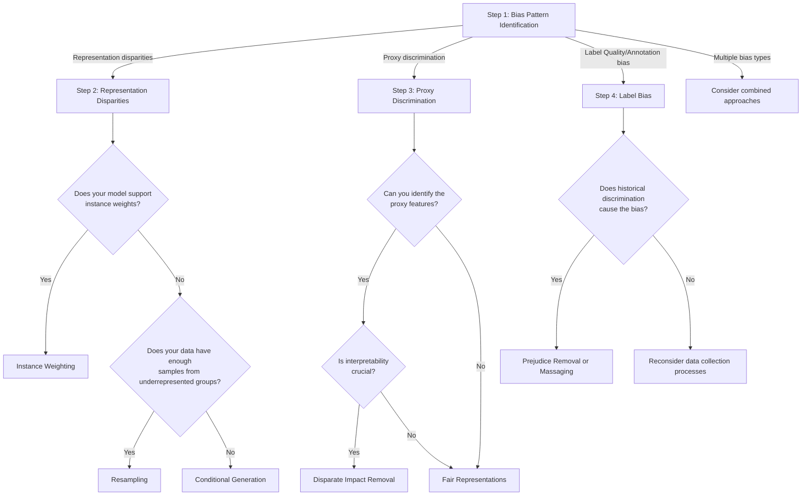

# Pre-Processing Fairness Toolkit

## **Purpose & Scope**

*   **Problem:** Data scientists frequently treat datasets as fixed constraints rather than malleable materials, which allows historical biases to become encoded into machine learning models. These biases manifest as representation disparities, problematic correlations (proxies), and biased labels, leading to discriminatory model behavior in critical sectors like lending and healthcare.
*   **Primary Function:** The toolkit provides a structured methodology to tackle bias at its source—the data itself—before it is encoded in models. It provides the diagnostic foundation for identifying bias mechanisms and offers specific techniques to transform biased datasets into fairer representations.
*   **Outputs:** The toolkit generates several key deliverables:
    *   A **technique catalog** documenting pre-processing approaches (reweighting, transformation, and generation) with their mathematical foundations and use cases.
    *   A **selection decision tree** to guide choices based on identified bias patterns, fairness definitions, and operational constraints.
    *   **Configuration guidelines** for tuning interventions to specific contexts.
    *   An **evaluation framework** to measure the impact on fairness, information preservation, and computational cost.
*   **Scope / Limits:** The scope is focused on **data-level interventions (pre-processing)** within the machine learning lifecycle. It specifically addresses multidimensional representation disparities, proxy discrimination, and label quality. However, the toolkit is limited by the inherent tension between achieving fairness and preserving **predictive utility**, requiring informed trade-offs in specific contexts.

## **Primary Stakeholders**

*   **Data Scientists:** They are the primary users of the toolkit, responsible for analyzing representation disparities, implementing technical interventions like reweighting or generative augmentation, and validating improvements.
*   **Compliance and GRC Officers:** These stakeholders ensure that the algorithm and the data-level interventions meet regulatory requirements and non-discrimination legal standards.
*   **HR and Domain Leaders:** In domains like hiring or finance, these leaders provide the necessary context to interpret audit findings and ensure that interventions align with organizational values and fairness goals.
*   **Clinical and Operational Teams:** In specialized sectors like healthcare, these teams rely on the toolkit to ensure that equitable access to resources is maintained and that legitimate medical relationships are preserved while removing biased access patterns.

## **Integration Points in the GRC Lifecycle**

*   **Risk Identification & Auditing:** The lifecycle begins with **comprehensive data auditing** to establish a diagnostic foundation. This identifies source risks—such as representation gaps and proxy discrimination—before they propagate into the model.
*   **Policy and Baseline Alignment:** Calculating baseline fairness metrics translates descriptive findings into quantitative benchmarks aligned with specific **normative fairness definitions** (e.g., equalized odds or demographic parity).
*   **Compliance in the Data Pipeline:** Interventions like resampling and distribution transformation are integrated directly into the **data preparation pipeline**, ensuring that models are trained on fair representations by design.
*   **Continuous Validation & Review:** The **evaluation framework** provides a persistent monitoring mechanism to assess the impact of interventions on fairness and information preservation, ensuring that technical trade-offs are documented and justified.
*   **Deployment & Operational Control:** The toolkit ensures transformation logic is consistently applied to new data during inference, while **weight drift detection** helps monitor and prevent gradual deviation from the intended fairness balance during deployment.

The toolkit will help any team tackle data-level biases in AI systems methodically and effectively.

## 1 The Technique Catalog 
   
This technique catalog documents the primary **pre-processing interventions**—data-level strategies designed to tackle bias at its source before it is encoded into machine learning models. These methods treat training data as "malleable materials" rather than immutable facts, allowing for the creation of fairer representations through reshaped distributions and reweighted samples.

### 1. Reweighting (Instance Weighting)
Reweighting modifies the **instance influence**—how strongly each training example impacts the model's learning process—without changing the physical composition of the dataset.

*   **Mathematical Foundation:** This approach typically assigns weights $W$ that are **inversely proportional** to the representation of specific attribute-outcome combinations based on $P(A,Y)/(P(A)\cdot P(Y))$ to break the correlation between $A$ and $Y$.
*   **Strengths:** It is versatile and relatively simple to implement, integrating seamlessly into existing workflows without modifying feature values or model architectures. It preserves the original feature distributions within groups.
*   **Limitations:** Naive application can lead to **sample variance effects**, estimation bias, and distorted probability estimates, effectively reducing the functional sample size.
*   **Use Cases:** Addressing historical imbalances in **loan approval datasets** where minority applicants have been disproportionately rejected despite creditworthiness.

### 2. Resampling Strategies
Resampling physically alters the composition of the training set by selectively including, duplicating, or generating instances to achieve a more balanced demographic distribution.

*   **Mathematical Foundation:** Techniques include **uniform sampling** (equal counts per group), **preferential sampling** (selective inclusion of bias-reducing examples), and **synthetic techniques** like SMOTE, which generate new examples for underrepresented groups to balance $A \times Y$ distributions.
*   **Strengths:** It is particularly valuable for frameworks or algorithms that **do not support instance weights**. It creates a balanced learning environment that prevents models from overlooking patterns in minority groups.
*   **Limitations:** Aggressive oversampling can lead to **overfitting** on specific patterns or poor model calibration, where predicted probabilities no longer reflect true risks.
*   **Use Cases:** Enhancing **medical diagnosis algorithms** where data from certain demographic populations is extremely limited, ensuring the model does not optimize solely for the majority.

### 3. Distribution Transformation (Disparate Impact Removal)
This method addresses **proxy discrimination** by modifying the feature space itself to break problematic correlations between "neutral" features and protected attributes.

*   **Mathematical Foundation:** It "repairs" features by mapping the distribution of a variable within each protected group to a **common median distribution**. This ensures the distribution becomes independent of the protected attribute while **preserving rank-ordering** within each group to maintain utility.
*   **Strengths:** It allows features like zip codes or communication styles to be used for their legitimate predictive value while preventing them from serving as vehicles for bias.
*   **Limitations:** Practitioners must balance fairness improvements against **predictive power**, as over-transformation can destroy legitimate signals needed for accuracy.
*   **Use Cases:** Transforming a feature like "distance from a financial center" in **credit scoring** so its distribution is identical across racial groups.

### 4. Optimal Transport for Fair Representations
Optimal transport offers a principled mathematical framework for transforming multidimensional distributions with minimal distortion.

*   **Mathematical Foundation:** It formulates distribution transformation as an optimization problem: finding the transformation that achieves fairness while **minimizing the "transportation cost"** (information loss).
*   **Strengths:** It is more sophisticated than independent feature transformation, as it can consider **complex relationships** between variables and multidimensional feature spaces.
*   **Limitations:** Requires higher computational resources and complex mathematical modeling compared to simpler univariate transformations.
*   **Use Cases:** Calibrating features like **"leadership description"** in resume screening to ensure they have similar distributions across genders while preserving their relationship with job performance.

### 5. Learning Fair Representations (LFR)
LFR moves beyond modifying existing features to create entirely new feature spaces optimized for both fairness and utility.

*   **Mathematical Foundation:** It maps original features to a new representation that **statistically obscures protected attributes** while preserving information relevant to the prediction task (fidelity). It often uses **adversarial learning** to satisfy multiple fairness criteria simultaneously.
*   **Strengths:** It addresses bias at its root by fundamentally transforming how the AI system "sees" the data.
*   **Limitations:** The resulting features are often **latent representations**, which can be difficult for humans to interpret compared to original raw features.
*   **Use Cases:** Transforming highly dimensional or complex data types, such as **text or images**, where simple feature-level transformations are insufficient.

### 6. Conditional Generation (Group Fairness)
- **Mathematical Foundation**: Uses generative models (e.g., GANs or VAEs) to create synthetic data conditioned explicitly on protected attributes to ensure balanced representation.
- **Strengths**: Provides precise control over group proportions and feature distributions, allowing fairness to be satisfied by design.
- **Limitations**: Balancing fairness with fidelity (realism) is difficult; generated data may contain unrealistic artifacts.
- **Use Cases**: Employment datasets where synthetic candidates with identical qualification distributions are generated for all demographic groups.

### 7. Counterfactual Data Augmentation
- **Mathematical Foundation:** Creates "what if" scenarios by generating variants of individuals where the protected attribute is changed but all causally independent qualifications remain constant.
- **Strengths:** Directly targets the causal mechanisms of discrimination; encourages models to learn invariance to protected attributes.
- **Limitations:** Requires a robust causal understanding of the domain to differentiate between legitimate and problematic correlations.
- **Use Cases:** Healthcare risk prediction where the goal is to differentiate between genuine biological differences and inequities in healthcare access.

### 8. Prejudice Removal
- **Description:** Modifies labels to reduce correlation with protected attributes.
- **Use Cases:** Addresses historical bias in labels while preserving data distribution.
- **Strengths:** Targets label bias directly; maintains sample counts.
- **Limitations:** May introduce new biases; needs careful calibration.
  

### Special Consideration: Intersectionality
The sources emphasize that all pre-processing techniques must explicitly address **intersectional fairness**. Independent interventions for race and gender may fail to help, or even harm, groups at the intersection, such as **women of color**. Effective pre-processing requires stratified sampling and specialized weighting schemes that account for multiple attribute combinations simultaneously.

## 2 Selection Decision Tree
The Selection Decision Tree guides key decisions:

## 3 Configuration Guidelines
The Configuration Guidelines help tune each technique. 
To effectively tune fairness techniques to specific contexts, you must follow a structured hierarchy that begins with **staged auditing** to identify the underlying bias mechanism—whether it is a representation gap, a problematic correlation (proxy), or a label quality issue. Configuration should prioritize the **least invasive approach** first, only escalating to more complex interventions when simpler methods prove statistically unreliable.

### Instance Weighting Configuration:

### Tuning Based on Representation Imbalances
Reweighting and resampling are most appropriate for contexts where the data is high-quality but demographic groups are not represented proportionally to the reference population.

- **Instance Weighting:** For mild to moderate imbalances, assign weights inversely proportional to the representation of specific attribute-outcome combinations. For example, in lending, you would assign higher weights to minority approvals to counteract historical redlining.
- **Algorithmic Constraints:** If your ML framework does not support instance weights, use preferential resampling to physically alter the dataset composition while preserving important predictive patterns.
- **Calibration Adjustment:** To prevent distorted probability estimates in weighted data, implement cross-validation procedures specifically designed for weighted samples and monitor for overfitting or increased variance.

### Tuning Based on Proxy and Correlation Patterns
When causal analysis reveals **proxy discrimination**—where neutral features like zip code or communication style correlate with protected attributes—distribution transformation is required.

*   **Information Preservation:** Map feature distributions within each group to a **common median distribution**. This "repairs" the feature so it cannot predict the protected attribute while **preserving rank-ordering** to maintain its legitimate predictive utility.
*   **Multidimensional Complexity:** For complex, high-dimensional features where simple transformations might destroy too much signal, use **Optimal Transport** or **Learning Fair Representations (LFR)**. These methods find the transformation that minimizes "transportation cost" (information loss) while achieving independence from the protected attribute.

### Tuning for Severe Gaps and Causal Mechanics
Generative approaches should be reserved for high-risk contexts where data is scarce or causal mechanisms must be explicitly broken.

*   **Severe Representation Gaps:** If a subgroup has fewer than **20–30 samples** (or <5% of its expected proportion), use **Fairness-Aware GANs or VAEs** to synthesize new examples. 
*   **Causal Invariance:** In domains like healthcare or hiring, use **counterfactual augmentation** to create "parallel version" variants where only the protected attribute changes while **causally independent qualifications** remain constant. This helps models learn to ignore discriminatory pathways.
*   **Integration Strategy:** When mixing real and synthetic data, implement **importance weighting** to balance their influence and use a **gradual transition approach** to monitor for unrealistic synthetic artifacts.

### Tuning for Intersectional and Domain Contexts
*   **Intersectional Configurations:** Do not treat attributes in isolation. Use **multi-attribute conditioning** and specialized weighting schemes that explicitly target specific intersections (e.g., Black women) to prevent aggregate improvements from masking deep subgroup disparities.
*   **Healthcare Context:** Distinguish between **legitimate biological differences** (which should be preserved in the data) and **historical inequities in access** (which should be mitigated through generation or transformation).
*   **Employment Context:** Address subtle **linguistic patterns** in resumes that function as proxies for gender by using feature groups and ranking features by their proxy potential.

### Evaluation and Validation Guidelines
*   **Fairness-Utility Trade-offs:** Every intervention must be tuned by evaluating it against a baseline to find the **optimal trade-off point** between fairness metrics and predictive power.
*   **Sensitivity Analysis:** For contexts with missing protected attributes, use **validated proxy methods** (like geographic analysis) combined with sensitivity analysis to understand how different assumptions affect fairness conclusions.
*   **Significance Testing:** Apply **statistical significance testing** to disparities and use **confidence intervals** to ensure that fairness improvements are meaningful rather than results of noise.

## 4 Evaluation Framework

The Evaluation Framework assesses intervention effectiveness:

### Fairness Assessment:

Measure primary fairness metrics aligned with your chosen definition
Check intersectional fairness across multiple protected attributes
Run statistical significance tests on improvements
Compare results across metrics to spot trade-offs

### Information Preservation:

Measure predictive performance changes (accuracy, AUC, F1)
Check rank ordering preservation within groups
Assess calibration consistency across groups
Compare feature importance before and after intervention

### Computational Efficiency:

Document processing time and memory needs
Test scaling with dataset size
Measure training time with transformed data
Assess deployment implications

## 5 User Documentation

This documentation provides a structured methodology for applying the **Fairness Intervention Playbook**, specifically focusing on the **Pre-Processing Fairness Toolkit** to mitigate bias at the data level before model training begins. By treating data as a malleable material rather than a fixed constraint, this toolkit enables teams to systematically diagnose and repair discriminatory patterns.

### Step 1: Conduct a Comprehensive Data Audit
Before selecting an intervention, you must establish a diagnostic foundation to identify the specific mechanisms of bias in your training data.

*   **Initial Profiling and Documentation:** Document your data sources, collection methodologies, and potential selection biases while identifying protected attributes and potential proxies based on domain knowledge.
*   **Multidimensional Representation Analysis:** Examine demographic distributions across protected attributes and their **intersections** to identify representation gaps that aggregate statistics might mask. For example, a dataset might show adequate representation for "women" and "people of color" separately, yet reveal a severe underrepresentation of "women of color".
*   **Correlation and Association Pattern Detection:** Identify problematic associations where ostensibly neutral features (like zip code or resume language) serve as **proxies** for protected attributes.
*   **Label Quality Assessment:** Evaluate if historical discrimination or annotator preferences are embedded in your training labels, which can lead to biased models even if features are balanced.
*   **Baseline Fairness Calculation:** Compute initial fairness metrics—such as **Statistical Parity**, **Equal Opportunity**, or **Equalized Odds**—on the raw data to quantify the gap that your intervention must address.

### Step 2: Select the Appropriate Intervention
Use the **Selection Decision Tree** to match your audit findings to the correct technical approach.

*   **For Representation Disparities:**
    *   If the model supports instance weights, apply **Reweighting** to adjust the influence of underrepresented groups.
    *   If weights are not supported, use **Resampling** (oversampling or undersampling) to physically alter the dataset composition.
    *   If representation gaps are **severe** (e.g., fewer than 30 samples for a subgroup), use **Fairness-Aware Data Generation** to synthesize entirely new examples.
*   **For Proxy Discrimination:** Apply **Distribution Transformation** techniques, such as **Disparate Impact Removal**, to modify features so they cannot predict protected attributes while still preserving their legitimate predictive utility.
*   **For Label Bias:** Implement label-level interventions like **Prejudice Removal**, relabeling, or label smoothing to correct historical inequities embedded in the outcome variables.

### Step 3: Configure and Tune the Intervention
Follow the **Configuration Guidelines** to balance fairness gains against information preservation and model stability.

*   **Instance Weighting:** Set your weighting scheme based on the fairness goal (e.g., inverse frequency for demographic parity) and cap weights to prevent model instability.
*   **Feature Transformation:** Select features strongly correlated with protected attributes and set the **repair level** (intensity). Start with a moderate repair level (e.g., 0.5) and adjust based on the trade-off between fairness and predictive power.
*   **Generative Models:** When using GANs or VAEs, formulate fairness constraints as explicit model components and implement regularization to prevent the generator from simply duplicating original data biases.

### Step 4: Evaluate and Validate Results
Use the **Evaluation Framework** to assess the impact of the intervention across three pillars:

*   **Fairness Impact:** Measure primary fairness metrics and specifically check for **intersectional fairness** to ensure aggregate improvements do not mask residual disparities for subgroups.
*   **Information Preservation:** Quantify changes in predictive performance (Accuracy, AUC, F1) and ensure that **rank-ordering** within groups is preserved.
*   **Computational Cost:** Document the additional processing time, memory needs, and deployment implications of the pre-processing steps.

### Step 5: Operational Integration
Integrate these transformations into your **standard ML pipeline**, ensuring that the same transformation logic applied to training data is consistently applied to new data during inference. Document every step—from auditing findings to final evaluation—to maintain transparency and satisfy regulatory or compliance requirements.
